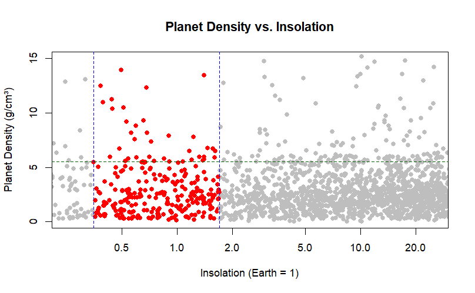
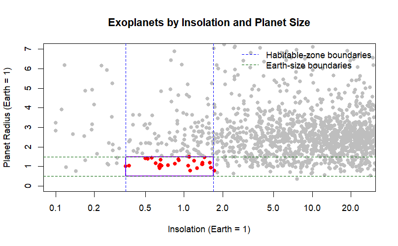
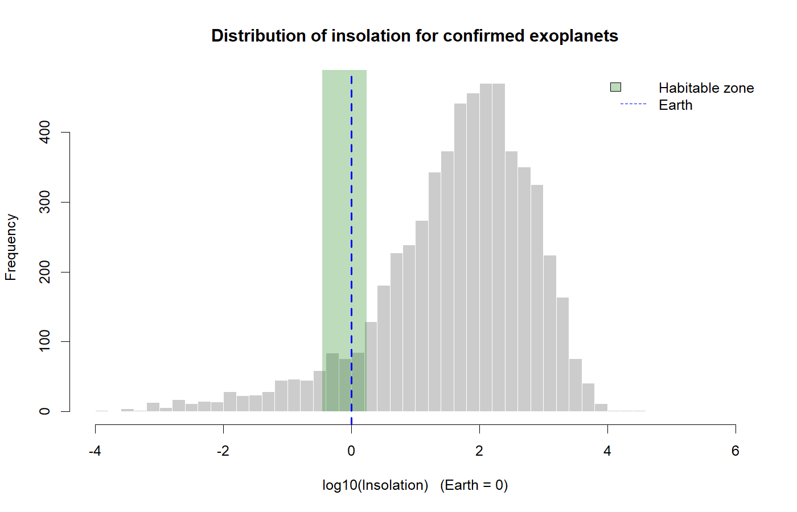
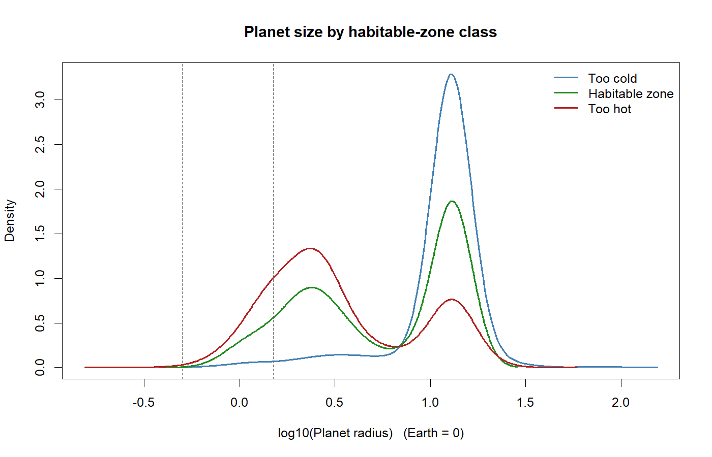
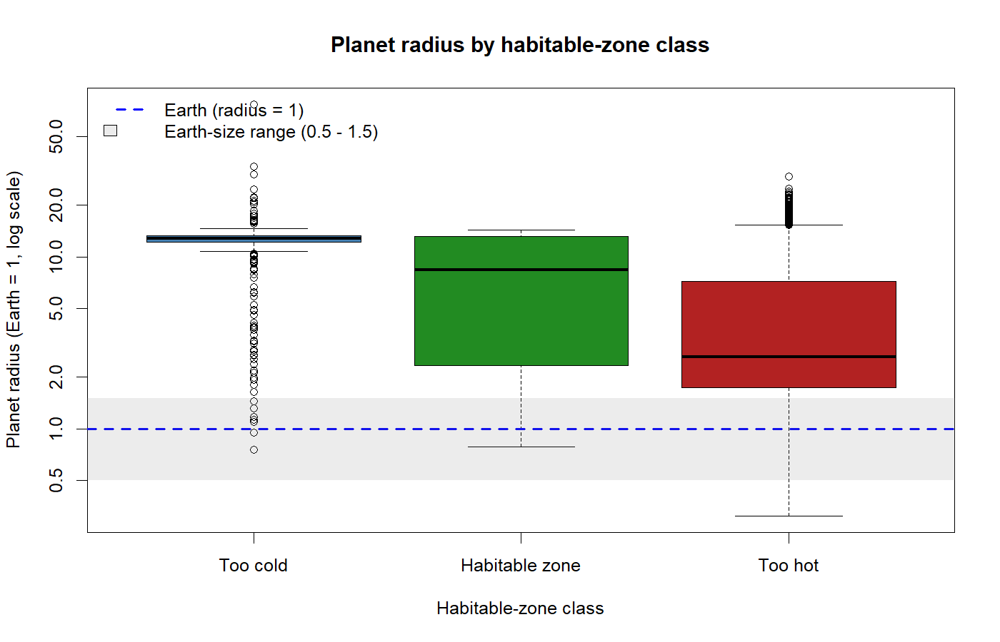

```{r setup, include=FALSE}
knitr::opts_chunk$set(echo = TRUE)
```
# Github link: https://github.com/JeffreyXia05/Stat107_FinalProject 

# Abstract

How many confirmed exoplanets orbit within their star's habitable zone, and how do they compare to Earth? Using the NASA Exoplanet Archive's Planetary Systems Composite Parameters table (6,451 planets), we cleaned the data in R and classified each planet by insolation, the energy it receives from its star relative to Earth. We defined the habitable zone as 0.35 to 1.75 times Earth's insolation and Earth-sized as 0.5 to 1.5 Earth radii.

Of the 5,855 planets with measured insolation, only 290 (5.0%) fall in the habitable zone, while 87.9% are too hot because they orbit very close to their stars. Most habitable-zone planets are not Earth-like: 91% are larger than 1.5 Earth radii (median 8.4), so many are likely gas giants. Only 27 planets are both Earth-sized and in the habitable zone, including TOI-700 d, TRAPPIST-1 d and Teegarden's Star b, and all orbit stars cooler than the Sun. Earth-like conditions therefore appear rare among known exoplanets, although detection methods favor large, close-in planets, so the true fraction may be higher.

# Introduction

Since the first exoplanet around a Sun-like star was confirmed in 1995, the question of whether Earth is unique has become one we can test with data. NASA's Exoplanet Archive now lists more than 5,000 confirmed planets, and most are very different from Earth, from gas giants orbiting closer than Mercury to scorched rocks hot enough to melt metal. Against this variety, our analysis asks: out of all confirmed exoplanets, how many fall inside the habitable zone, and how does our solar system compare?

The habitable zone is the range of distances from a star where a planet could, in principle, hold liquid water on its surface. Because the energy a planet receives depends on both the star's brightness and the planet's distance, we define the zone using insolation, the stellar flux a planet receives relative to Earth. We supplement this with orbital distance, planet radius, and equilibrium temperature to see how these planets resemble or differ from Earth.

Our approach is descriptive, not predictive: we are not training a model or classifying planets with a learned algorithm. Instead, we apply a physically motivated threshold to the NASA Planetary Systems Composite Parameters table. So far, we have downloaded and cleaned the data in R and begun counting the planets that fall within our chosen range. In the remaining weeks, we will finish the comparison with Earth and create visualizations of our results. By the end of the project, we hope to give a clear, reproducible answer to how common Earth-like conditions are among known exoplanets.

# Executive Summary

- **Habitable-zone planets are rare.** Only 290 of the 5,855 planets with measured insolation (5.0%) receive between 0.35 and 1.75 times Earth's insolation.
- **Most known exoplanets are far too hot.** 87.9% receive more energy than the habitable zone allows. The median planet receives about 67 times Earth's insolation, because most orbit very close to their stars (median orbital distance 0.10 AU).
- **Most habitable-zone planets are not Earth-sized.** 91% are larger than 1.5 Earth radii (median 8.4), so many are likely gas giants rather than rocky worlds.
- **Only 27 planets are both Earth-sized and in the habitable zone.** All of them orbit stars cooler than the Sun (at most 4,925 K vs. 5,772 K). The closest match to Earth is Teegarden's Star b, with 1.08 times Earth's insolation and 1.05 Earth radii.
- **These counts are a lower bound.** Detection methods favor large planets close to their stars, and 596 planets (9.2%) have no insolation measurement, so Earth-like planets are likely undercounted.

# Data

The data for this project come from the NASA Exoplanet Archive, which is maintained by the NASA Exoplanet Science Institute at Caltech. We downloaded the Planetary Systems Composite Parameters (PSCompPars) table, which contains one row per confirmed exoplanet. Each row combines the best available measurements for that planet and its host star, drawn from many published studies. Because the values are measured and compiled from the literature, the data are observational, not simulated, so no data generating procedure is needed.

The table contains more than 5,000 observations, one for each confirmed planet, and a large number of variables. We focused on six: planet name (`pl_name`), insolation relative to Earth (`pl_insol`), orbital semi-major axis in astronomical units (`pl_orbsmax`), planet radius in Earth radii (`pl_rade`), equilibrium temperature in kelvin (`pl_eqt`), and host star effective temperature in kelvin (`st_teff`). Insolation is the main variable for identifying habitable-zone planets, while the others support the comparison with Earth.

We cleaned the data in R. First, we confirmed the number of planets in the table and selected only the six columns above. Next, we checked each of these columns for missing values, since not every planet has every measurement. Many planets lack an insolation value, so we kept only planets with a non-missing `pl_insol` when counting habitable-zone candidates and calculating percentages. We also checked that the remaining values were physically reasonable and that each planet appeared only once, which is expected in PSCompPars because it keeps a single composite row per planet. Finally, we organized the cleaned data into a single data frame that we use for all later steps.

## Visualizations
```{r}


```

This graph plots planet density vs Insolation. Insolation similar to Earth is from around 0.3 - 1.7 and density is 5.5. We can see that only a handful of Exoplanets have around the same Insolation and density as Earth. 

```{r}

```

This graph compares Planet Radius vs Insolation. Insolation similar to Earth ranges from 0.3 - 1.7 and Radius ranges from 0.5 - 1.5. Again only a handful of exoplanets fit in the ranges similar to earth.

```{r}

```

This histogram shows the distribution of insolation for the 5,855 planets with a measured value, on a log scale where Earth is 0. The green band is the habitable zone (0.35 - 1.75 times Earth's insolation). The distribution peaks around 100 times Earth's insolation, and about two-thirds of planets receive between 10 and 1,000 times what Earth does. Only a thin slice of the catalog falls inside the green band.

```{r}

```

This density plot compares planet size for planets that are too cold, in the habitable zone, and too hot. The dashed lines mark the Earth-size range (0.5 - 1.5 Earth radii). All three groups have two peaks: one at about 2 - 3 Earth radii (super-Earths and mini-Neptunes) and one at about 13 Earth radii (Jupiter-sized giants). Too-hot planets are mostly in the smaller peak, while too-cold planets are almost all giants. Very little of any curve falls inside the Earth-size range.

```{r}

```

This box plot shows the same comparison as medians and quartiles. The dashed blue line is Earth and the grey band is the Earth-size range. The median habitable-zone planet is 8.4 Earth radii, and only the bottom whisker reaches the Earth-size band. Too-hot planets are smaller (median 2.6) and too-cold planets are almost all giants (median 12.8).

```{r}
knitr::kable(read.csv("../Data/Cleaned/numeric_summary.csv"), digits = 2,
             caption = "Numerical summary of the main variables")
```

The numerical summary shows that insolation, orbital distance, radius and mass are strongly right-skewed: each mean is much larger than its median. For example, the median insolation is 66.7 times Earth's but the mean is 531.9, because a few planets are extremely hot. The median planet orbits at only 0.10 AU, about a quarter of Mercury's distance from the Sun. Because of this skew, we use medians and log scales throughout.

## What the visualizations suggest

Together, these plots support our expectation that Earth-like conditions are rare among known exoplanets. Most planets receive far more energy than Earth, so only 5.0% fall in the habitable zone. Even within the habitable zone, most planets are much larger than Earth and are likely gas giants. Only 27 planets meet both the insolation and the size criteria. The plots also show a strong detection bias: the catalog is dominated by large planets on short orbits, which are the easiest to detect. This means our counts describe the known catalog, not the true population of planets in the galaxy.

## Planned visualizations

- **Sensitivity bar chart:** the number of habitable-zone planets under the conservative and optimistic definitions, side by side.
- **Host star temperature box plot:** star temperature for each habitable-zone class, to test whether Earth-sized habitable-zone planets mostly orbit cool, small stars.
- **Equilibrium temperature histogram:** `pl_eqt` for habitable-zone planets compared to Earth's 255 K.
- **Candidate scatter plot:** insolation vs. radius for only the 27 Earth-sized habitable-zone planets, labeled by name, with Earth marked for comparison.

# Analysis

Our analysis is descriptive and has two remaining parts: comparing habitable-zone planets with Earth and checking how sensitive our findings are to our choices. Below are the plans for what we aim to finish in the remaining weeks.

## Comparison with Earth

For the planets we identified in the habitable zone, we will compare orbital distance (`pl_orbsmax`), radius (`pl_rade`), and equilibrium temperature (`pl_eqt`) with Earth's values, using summary statistics such as the median and range. We will also separate planets by size, since a planet in the habitable zone that is many times Earth's radius is more likely a gas giant than a rocky world. We expect many habitable-zone planets to be larger than Earth, in part because current detection methods favor larger planets. We will also use host star temperature (`st_teff`) to see which kinds of stars host these planets.

## Sensitivity Check

To see how much our answer depends on how the habitable zone is defined, we will repeat the count under an optimistic definition (about 0.2 to 1.7 times Earth's insolation) alongside our conservative one (about 0.36 to 1.11) and compare the number and percentage of planets under each:

$$\text{Percentage} = \frac{N_{\text{HZ}}}{N_{\text{with insol}}} \times 100$$

We expect the habitable zone to contain only a small fraction of the catalog under either definition, because most known exoplanets orbit very close to their stars and receive far more energy than Earth.

# Summary of Individual Contributions

- **Joseph Biehn:** Loading data, data cleaning, and functions
- **Joshua Arevalo:** Data analysis
- **Jeffrey Xia:** Report and README

